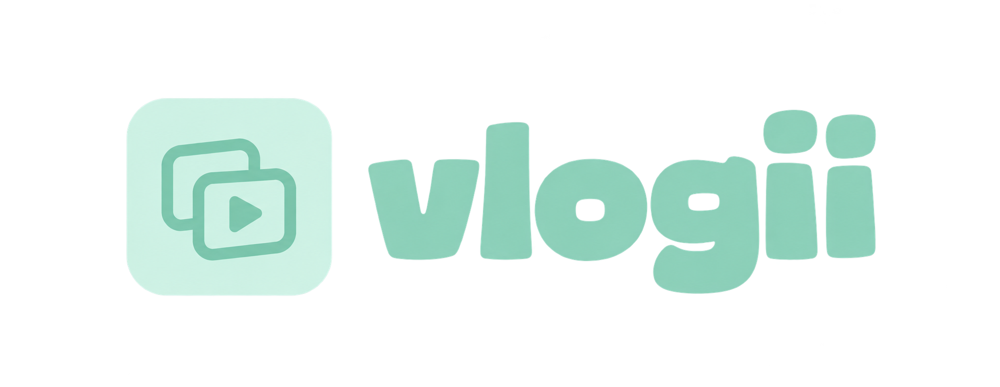

# Vlogii

[中文](README.md) · **English**



Turn everyday footage into a short vlog you can preview, edit and export. The current release is a local web MVP with Chinese/English interfaces and CLI.

**Upload → Gemini visual analysis and speech transcription → selection and frame timeline → FFmpeg export → preview, edit, retry, undo and download.**

The product direction is an artistic/sticker cover, opening highlights and a captioned body with occasional annotations. Highlights currently export separately; covers and automatic opening/body assembly are pending. See the [Shorts direction](docs/shorts-direction.en.md) and the selected mint-green [brand identity](docs/visual-design.en.md#brand-logo).

Integration branch `codex/integrate-feng-ui` combines the teammate’s editorial frontend with generation, retry and editing from `kang`: a mint palette, chapter navigation, full-width player and bundled web fonts.

## Start locally

Requirements: macOS or Linux, Python 3.11+, Node.js 20+, [uv](https://docs.astral.sh/uv/), and FFmpeg with text, audio, H.264/HEVC support. Ubuntu setup is in the [guide](docs/vlogii-guide.md).

```sh
# macOS
brew install ffmpeg-full
git clone --branch codex/integrate-feng-ui https://github.com/yoko3new/Auto_Vlog_Editor.git vlogii
cd vlogii
uv sync --frozen --extra dev
cp .env.example .env
```

Set `GEMINI_API_KEY` in your local `.env`, then build and start:

```sh
npm --prefix frontend ci
npm --prefix frontend run build
uv run vlogii doctor
uv run vlogii serve
```

Open **http://127.0.0.1:8000**. macOS automatically prefers Homebrew's `ffmpeg-full`. Run one server process; this release has no authentication and is intended for local use.

## Current features

- Import MP4, MOV, M4V or MKV, inspect metadata and deduplicate files. Gemini processes visual proxies and original audio separately; captions retain the source language and fit output dimensions.
- Chinese/English switching, optional creative direction and clickable input examples; the user confirms before submitting.
- Portrait/landscape, original audio, captions and occasional text. SDR/H.264 is the default; all-HLG footage can preserve 10-bit HEVC.
- Edit titles, warmth, clip exclusions, film time-range removals and whole-film or local speed; captions and audio follow the timeline.
- Successful versions, preview, undo and download. Failures preserve old films; Retry reuses saved requests, valid analysis caches and completed render segments.

| Generation mode | Default behavior |
| --- | --- |
| AI auto | Chooses content and duration from footage and direction; no default 30-second limit |
| Opening highlights | Separate montage aiming for 5 seconds; up to about **0.5 seconds per shot, 1× speed, muted**, without speech captions |
| Keep most | Import order, remove black frames and long speech gaps; retain silent scenery unless removal of all intervals without recognized speech is enabled |
| Keep all | Preserve all imported source intervals in import order; playback speed changes output duration |

AI auto/highlights accept approximate targets of 1–1800 seconds; retention modes derive duration from content. Footage is never repeated to fill a target. The web UI provides cadence and speed radio groups. Time changes use the **current successful film**, such as “delete 00:12 to 00:18” or “speed up 00:12 to 00:18 to 2x”. See [editing rules](docs/editing-modes.en.md).

Configured defaults are `gemini-3.8-flash` for visuals/planning and `gemini-3.5-transcribe` for speech, using one Gemini key; both can be changed in `.env`. A live sample passed, but accuracy still needs human comparison; see the [fix record](docs/mvp-fixes.en.md). Gemini receives visual proxies and audio. Keys, footage, transcripts, caches and exports are excluded from Git.

Limits: 50 clips, 512 MB per clip, 2 GB per upload and 30 minutes of source footage. Warmth edits use SDR; HEVC playback depends on the browser and device.

## CLI and checks

```sh
uv run vlogii                          # Interactive language selection
uv run vlogii --language zh init my-day /absolute/path/to/footage --color sdr
uv run vlogii --language zh run my-day --mode keep_all
uv run vlogii --language zh run my-day --mode highlights --shot-seconds 0.5 --speed 1
uv run vlogii --language zh edit my-day --instruction "00:12到00:18加速到2倍"
uv run vlogii --language zh retry my-day
```

```sh
uv run pytest -q
uv run ruff check src/vlogii tests
uv run ruff format --check src/vlogii tests
npm --prefix frontend run build
python3 tools/check_docs.py
```

The latest code validation recorded **95 passing Python tests**, including real FFmpeg exports, and a successful frontend build. Provider test doubles validate program behavior only; AI quality and remaining limitations are in the [validation record](docs/vlogii-validation.md).

## Documentation and ownership

Each document has a Chinese/English language switch at the top; code, field names and commands remain in English.

- [Mac / Safari setup](docs/vlogii-mac-setup.en.md) · [User guide](docs/vlogii-guide.md) · [Feature coverage](docs/mvp-coverage.en.md) · [Current status](docs/status.en.md)
- [Editing rules](docs/editing-modes.en.md) · [Product definition](docs/product.en.md) · [Architecture](docs/architecture.en.md)
- [Free font/BGM candidates and licenses](docs/free-resources.en.md): research and downloads are complete; bundled presets, mixing and custom uploads are pending.
- [Team handoff](docs/collaboration.en.md): Yang Kang owns video, AI, backend, rendering and integration; the teammate owns the frontend.
- [Current OpenAPI](docs/vlogii.openapi.json): `/api/vlogii`, runtime `/docs`; the [older competition contracts](docs/contracts.en.md) are planning references.

Pending: artistic/sticker covers, automatic opening/body assembly, BGM/beat matching, film styles, arbitrary semantic natural-language edits, authentication, cloud storage and deployment. Full competition acceptance remains incomplete; the current implementation has a separate boundary from the older `/api` contract.
