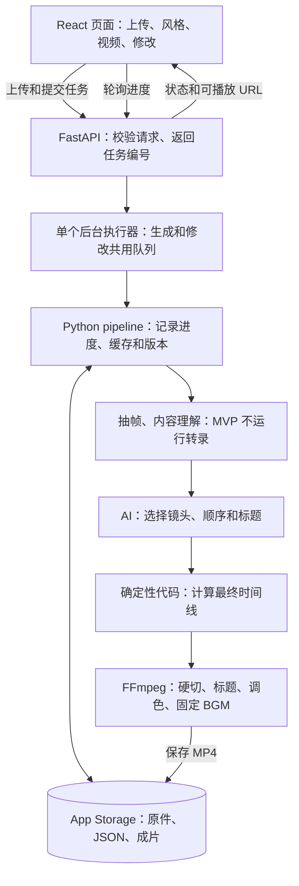

# Architecture and Implementation Boundaries

[中文](architecture.md) · **English**

[Return to Project Overview](../README.en.md)

When to read: Read relevant subsections when original competition service boundaries, task execution, or storage designs change. For the current `kang` implementation layout and startup method, see [Vlogii Guide](vlogii-guide.md), and for actual capabilities, see [MVP Comparison](mvp-coverage.en.md); existing code is located in `src/vlogii/`, while `core/`, App Storage, and directory trees on this page are plans and must not be treated as implemented. The full video pipeline belongs to A (Yang Kang), and the frontend belongs to B (teammate).

<a id="s3"></a>

## Frontend, Backend, and Storage: Recommended Overall Design

<a id="s3-1"></a>

### Concepts for Beginners to Remember First

| Name | What it does in this project | Recommended implementation |
| --- | --- | --- |
| Frontend | In-browser upload area, style cards, main video player, edit box | React + TypeScript + Vite; Tailwind + shadcn/ui handle styles and components |
| Backend | Receives requests, calls AI, computes timelines, executes editing | Python + FastAPI, reusing independent `core/` modules |
| Task executor | Processes time-consuming generation and modifications one by one | A serial queue + a background execution thread; FFmpeg runs as a subprocess |
| Storage | Stores footage, analysis, versions, and finished videos | Local debugging uses directories + JSON; online persistent files use Replit App Storage |
| Replit | Hosts code, runs the development environment, previews and publishes the application | Hosts the above application; will not automatically replace video processing code |

**Frontend and backend have a division of labor, but are kept in the same repository and preferably deployed as a single application.** During development, Vite handles page preview and proxies `/api` requests to FastAPI; during release, the frontend is built first, and then FastAPI serves the built web pages and API, with the browser accessing only a single address. The backend listens on `0.0.0.0`, with the port set according to Replit's actual runtime configuration.

React was chosen because Replit is now confirmed, and the Adobe Creative demonstration requires a relatively flexible visual layout, allowing Codex / Replit Agent to help build components. It still involves more API integration work than Gradio, so a closed loop from upload to playback must be achieved within the first 6 hours. When milestones are incomplete, locate bottlenecks first; consider a fallback Gradio interface only if the React interface itself is blocked and the minimal API is already working. Rendering or API issues cannot be solved by switching the frontend, nor should two sets of pages be maintained simultaneously.

<a id="s3-2"></a>

### Architecture Diagram



What runs on Replit is your frontend and backend code; visual comprehension calls external AI APIs, and FFmpeg completes editing on the backend machine. The browser handles interaction and playback. Do not put video transcoding in the browser as the primary path for the first version.

<a id="s3-3"></a>

### Core Boundary: AI Provides the Plan, Code Computes, Renderer Executes

AI is good at "which shots go well together," while deterministic code is good at "which frame this shot should start from." Therefore, it is split into two files:

- `edit_plan.json`: AI provides shot order, candidate trim ranges, chapters, and titles.
- `timeline.json`: Final playback arrangement computed by the program, handed over to the renderer for direct execution.

Do not let the renderer change shot lengths on the fly; otherwise, subtitles, voiceover, transitions, and total duration will all change accordingly.

The schema can catch incorrect fields and illegal values, but it cannot guarantee a sensible story, absence of duplicate shots, or attractive titles. Business logic checks and actually watching the final video are also required.

<a id="s4"></a>

## Module Breakdown and Directory Structure

The following modules cover the MVP and subsequent stages; the MVP does not implement responsibilities labeled as V2/V3. Write each backend module as a single Python file first, without needing to split into separate services.

| Module | Responsibility | Primary Output |
| --- | --- | --- |
| `ingest` | A is responsible for saving originals, registering stable asset IDs, reading metadata and orientation, and generating thumbnails | `assets.json` (uniformly includes videos and other assets) |
| `analyze` | MVP frame extraction, content description, basic quality ranking; transcription added only in V2-3 | `analysis.json`; V2-3 adds `transcript.json` |
| `music` | MVP reads a fixed track and precomputed beats; music selection by mood added only in V2-1 | `beats.json` |
| `director` | MVP shot selection, ordering, and short titles; visible chapter tags added in V3-3 | `edit_plan.json` |
| `timeline` | MVP computes hard cut points, durations, and calls title layout functions maintained by A; subtitles and transitions added in V2/V3 | `timeline.json` |
| `intent` | Converts user text into controlled operations, or returns pending-selection/unsupported | `edit_request.json`, contract see [`edit_request.json`: Modifications are controlled operations, not arbitrary JSON patches](reference/timeline.en.md#s6-8) |
| `style` / `settings` | Reads styles, merges project settings, validates | Configuration objects and version snapshots |
| `render` | Asset normalization, visual and audio compositing | `final.mp4` |
| `titlecard` | MVP generates fixed titles and decorations; V2-3 adds subtitles | MVP uses transparent PNG; ASS is used only in the subtitle stage |
| `pipeline` | Invokes the above steps, records progress, caches, and versions | Project status, successful versions |
| `api` / `jobs` | HTTP interface, task queuing, status and result queries | JSON responses, media URLs |
| `frontend` | Page layout, upload, polling, player, and download | Browser page |

Recommended repository structure:

```text
auto-vlog-editor/
  frontend/                  # React + Vite + TypeScript
    src/
      App.tsx
      components/            # 上传、风格卡、播放器、修改面板
      lib/api.ts             # 所有后端请求集中在这里
      index.css              # Tailwind 和统一设计参数
    package.json
  api/
    main.py                  # FastAPI 路由及前端静态文件
    jobs.py                  # 一个共享队列、后台执行器、进度
  .replit                    # 开发/构建/发布命令，按实际环境配置
  core/
    schemas.py               # 按[JSON 数据契约：MVP 可用，V2/V3 可扩展](reference/timeline.md#s6) JSON Schema 实现模型与业务校验
    ingest.py
    analyze.py
    music.py
    director.py
    timeline.py
    intent.py
    render.py
    titlecard.py
    pipeline.py
    storage.py               # 读写项目和版本
  style/
    style_schema.py
    presets/
  assets/
    fonts/
    luts/
    bgm/
    style_previews/
    decorations/
  contracts/                 # 已放入契约、HTTP 定义与 collaboration/ 开发替身
  tools/render_fixture.py     # A 负责的规划渲染 CLI，固定调用方式见[启动、配置与完成定义](collaboration.md#s13-6)
  fixtures/                  # 实际媒体、手工计划与验收样本
  work/projects/             # 上传、缓存和版本；不提交 Git
  .env.example               # 只列变量名，不含 API key
  requirements.txt           # 锁定验证通过的依赖版本
  README.md                  # 安装、启动、支持格式、演示步骤
```

<a id="s5"></a>

## Technical Route and Implementation Order

<a id="s5-1"></a>

### Default Technology Choices

| Part | Recommendation | Boundaries beginners need to know |
| --- | --- | --- |
| Language | Frontend TypeScript, backend Python 3.11+ | Both team members lock to the same verified versions of Node, Python, and dependencies |
| Page | React + Vite + Tailwind + shadcn/ui | Single-page editing console; do not add Next.js, complex state management libraries, or timeline editors |
| API & Tasks | FastAPI + single background executor | Submission immediately returns a task ID, frontend polls, does not block HTTP requests |
| Video reading & rendering | ffprobe, FFmpeg, invoked via subprocess | Save commands, exit codes, and error logs for easy reproduction |
| Image analysis | OpenCV | Perform brightness and sharpness ranking first; optical flow jitter detection deferred |
| Shot splitting | Process short clips by file first; add PySceneDetect when needed | Each mobile clip can generally be treated as a candidate unit initially |
| AI | Claude, Gemini, OpenAI are candidates to be validated; use any available provider to get the keyframe + text route working first | Ultimately integrate only one primary vendor. Prefer retaining already stable implementations; for evaluation methods, see [Comparison and Selection Methods for Currently Mature Solutions](ai-selection.en.md#s20) |
| Voice (V2-3) | Not integrated in MVP; compare cloud transcription with timestamps vs. local solutions only upon entering V2-3 | Select only one ASR; TTS voiceover belongs to V3-4 |
| Music | MVP fixes one track with precomputed beats; V2-1 adds a second track | No need to repeatedly analyze the same song at the competition site |
| Data validation | Pydantic v2 | Checks fields, types, ranges; write additional cross-field and footage boundary checks |
| Titles & subtitles | MVP uses Pillow transparent PNGs for fixed typography; ASS subtitles added only in V2-3 | Title and chapter animations belong to V3-3 |
| Data storage | JSON + media files; online persistent files placed in App Storage | The first version requires no database, restricted to a single instance and serial writes |

faster-whisper supports word-level timestamps and VAD (detecting whether voice is present); actual speed depends on the model, hardware, and settings. The official GPU route depends on NVIDIA CUDA, and graphics card benchmark speeds should not be directly applied to a Mac. [Official Repository](https://github.com/SYSTRAN/faster-whisper)

<a id="s5-2"></a>

### Footage Processing: Retain Originals, Normalize on Demand

1. Save original files and assign stable `clip_id`.
2. Use ffprobe to read duration, encoding, frame rate, rotation, and color information.
3. Extract low-resolution keyframes according to the actual viewing orientation; extract ASR audio additionally only after entering V2-3.
4. AI and rules select the required ranges.
5. Apply final size, frame rate, color, and pixel format processing only to selected ranges, then composite.

When encountering formats with unstable decoding or random seeking, first create normalized proxy files that retain the full frame, and preserve their time correspondence with the originals. Do not irreversibly crop the original frame at the very beginning just to unify to landscape orientation.

When implementing crossfade dissolves in V3-3, inputs to `xfade` must have unified frame rate, dimensions, pixel format, and timebase, and segment timestamps must be reset to zero. HDR-to-SDR conversion must explicitly perform color space conversion rather than only changing resolution. [FFmpeg Filter Documentation](https://www.ffmpeg.org/ffmpeg-filters.html#xfade)

<a id="s5-3"></a>

### Footage Comprehension: Prioritize Accurate Selection First

For each clip, evenly sample about 3 low-resolution frames first; increase sampling for longer clips or those with noticeable changes. Attach the original footage timestamp to each frame. A small number of static frames cannot fully judge motion processes; do not make AI guess out of thin air the exact moment when an action occurs.

MVP content analysis output must include at least: `clip_id`, candidate time range, a one-sentence description, activity tags, quality hints, and primary subjects. Only in V2-3 should speech presence be determined from audio and transcribed, avoiding letting static frame judgments substitute for speech detection. A single or batched multimodal call can generate these contents simultaneously, avoiding invoking the model separately for each minor field.

Clip selection priority: content relevance, duplicate avoidance, retention of key activities, followed by image quality scores. Dim night scenes or motion shots may have narrative value; quality scores are used for ranking by default, with hard exclusions applied only to clearly unusable frames.

Once verified on Replit at kickoff, perform a clip selection test with manual annotation according to [AI Footage Comprehension and Selection Test: First Test at Hours 6–7, Final Video Verification Before Hour 14](ai-selection.en.md#s20-4), then lock in the frame extraction method and primary model. When a moment is missed, check first whether it appeared in the frames sent to the model: if not present, adjust sampling; only if present yet ignored should you check prompts or model judgment. About 3 frames is a starting plan, not a proven-sufficient fixed standard.

<a id="s5-4"></a>

### Music and Voiceover

MVP uses only a single fixed BGM with all original audio muted; the following voiceover, sentence, and music ducking designs are enabled only in V2-3.

`librosa.beat_track` provides beat positions, not downbeats directly. The default returned unit is analysis frames; explicitly convert to seconds before writing to `beats.json`, or output using seconds units. Downbeats can be manually annotated for preselected tracks first. [Official Documentation](https://librosa.org/doc/main/api/generated/librosa.beat.beat_track.html)

At 80–100 BPM, each beat is about 0.6–0.75 seconds, so "cutting on every beat" and "shot length of 1.5–3 seconds" cannot hold simultaneously. Pick beats within the allowable duration as cut points; for example, at 92 BPM, 3 beats is about 1.96 seconds, and 4 beats is about 2.61 seconds.

Voiceover should first support short, clear transition sentences. Word-level timestamps do not equate to sentence boundaries; they need to be organized into sentences combining punctuation and pauses, with a small margin left at the beginning and end. Voiceover intervals must not be cut off merely to sync with beats.

Music ducking in V2-3 can directly use known voiceover intervals to smoothly lower and restore BGM volume, with parameters tuned by listening tests. This is more controllable than using all original audio to trigger compression, as impact noises and wind noise can also be very loud. `sidechaincompress` can serve as a subsequent implementation, but the sidechain control track must still be chosen correctly. Shots without voiceover have original audio muted by default; ambient sound design will be added subsequently.

<a id="s5-5"></a>

### Rendering and Speed

MVP should first be validated with hard cuts, followed by adding fixed BGM, titles, and color grading; subtitle and voiceover mixing belong to V2-3, and inter-segment dissolves belong to V3-3. Do not start by writing a massive filter chain containing all effects.

For output, first choose H.264 + AAC, MP4, and browser-standard pixel formats, and test playback in a real browser. `+faststart` can be used to improve MP4 loading experience. For encoding presets, compare the speed, size, and visual quality of `veryfast` and `ultrafast` first, then select the tier proven suitable by testing; fast encoding does not mean frame extraction, ASR, and AI calls are also fast.

When modifying, prioritize caching analysis results; the ~30-second video of the MVP can be fully re-rendered for now. Partial segment caching involves transitions, subtitles, and global timing changes, and should be deferred until testing proves it necessary.

<a id="s11"></a>

## Is a Database Needed: Skip for Single-Instance Demo, but Persistent Storage Is Required

<a id="s11-1"></a>

### Why Files and JSON Are Sufficient

This iteration commits only to a single instance and controlled demos, without multi-user simultaneous editing. A few projects can be managed with JSON, without adding a SQL database for now. The following directories are used as temporary workspaces for local debugging and cloud processing; content that needs to be retained online is stored in App Storage using the same project ID, and the runtime directory must not be treated as reliable permanent storage.

```text
work/projects/<project_id>/
  project.json               # 当前版本、素材列表、创建时间
  originals/                 # 原始上传文件，使用内部 ID 命名
  assets.json                # 视频/音乐/字体/图片的稳定资源清单
  analysis/
    analysis.json
    transcript.json
    keyframes/
  jobs/
    <job_id>.json             # 状态、开始时间、耗时、错误信息
  versions/
    v001/
      request.json           # 第一次生成或修改请求
      config.json            # 这一版风格和设置
      edit_plan.json
      timeline.json
      result.json            # 成功状态、摘要、父版本
      final.mp4
    v002/
      ...
  logs/
```

Project IDs use random unique values to avoid overwriting between different projects. Persistent JSON saves asset IDs and storage keys; local paths are resolved at runtime by storage. The video content itself is not encoded into large strings and written into JSON; for specific asset types, see [`assets.json`: Separate Stable IDs from Real Files](reference/timeline.en.md#s6-3).

<a id="s11-2"></a>

### Separate Page State from Permanent Records

React state stores the current page's `project_id`, selected version, and task ID. The backend stores the authoritative project record; after browser refresh, it is restored via `GET /api/projects/{id}`. Do not stuff all video bytes into React state or localStorage.

Replit's App Storage is object storage for videos, images, and files; databases are suitable for querying and relating structured records. Object storage is like a cloud file cabinet and is completely different from a SQL database. [Replit Storage Documentation](https://docs.replit.com/learn/projects-and-artifacts/storage-and-databases)

The first version encapsulates saving and reading via `core/storage.py`: local mode writes to directories, Replit mode saves originals, successful versions, and project JSON to App Storage; files used by FFmpeg are first placed into a temporary directory, and results are uploaded upon completion. Do not permanently upload all temporary frames. [App Storage Documentation](https://docs.replit.com/features/data-and-storage/object-storage)

To avoid adding an account system, the demo uses non-sensitive footage prepared by you and restricts access scope. Project IDs are not a full permission mechanism; when genuinely opened to arbitrary users uploading private videos, session ownership and access validation must be added.

<a id="s11-3"></a>

### Order of Saving Results

Local: write new version to an independent directory → render temporary MP4 → verify playable → rename to official filename → finally update project's current version. JSON is written to a temporary file first, then atomically replaced.

Object storage: upload immutable version files and metadata first → confirm upload success → finally update the project current version pointer. Do not assume object storage has the atomic renaming of local filesystems. Only one background executor submits generation results; API upload registration, task acceptance, version switching, and executor result submission all update records via the same project write lock maintained by A to avoid overwriting each other. The write lock does not cover the entire time-consuming rendering process.

Generation failures do not overwrite the previous playable video. After a process restart, mark leftover queued or running tasks as "interrupted, retryable." Having files saved does not mean tasks can resume automatically; resume from breakpoint is not committed to this time.

<a id="s11-4"></a>

### When to Add a Database

| New Requirement | Solution to Consider Then |
| --- | --- |
| Many single-machine projects requiring search, listing, and filtering | SQLite storing project and version metadata |
| Accounts, multi-user access, multiple backend instances | Databases like PostgreSQL + access control |
| Files require cross-server or long-term storage | Object storage storing videos, database storing references |
| Heavy rendering queues, automatic recovery after failure | Standalone task execution process and persistent task queue |

Databases primarily solve data management and will not automatically make FFmpeg faster. Confirm real requirements before adding.
