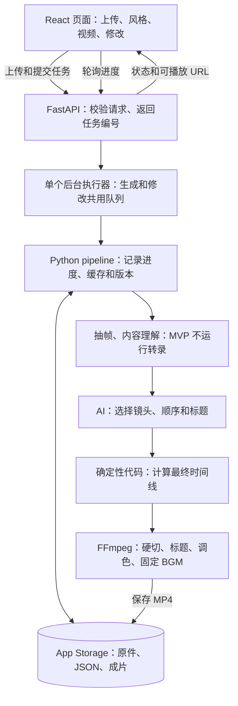

# 架构与实现边界

[返回项目总览](../README.md)

何时读：开始一个模块、修改服务边界、任务执行或存储时读相关小节。接口字段见 contracts.md。

<a id="s3"></a>

## 前端、后端和存储：推荐的整体设计

<a id="s3-1"></a>

### 初学者先记住这几个概念

| 名称 | 在这个项目里做什么 | 建议实现 |
| --- | --- | --- |
| 前端 | 浏览器里的上传区、风格卡、大视频、修改框 | React + TypeScript + Vite；Tailwind + shadcn/ui 负责样式和组件 |
| 后端 | 接收请求、调用 AI、计算时间线、执行剪辑 | Python + FastAPI，复用独立的 `core/` 模块 |
| 任务执行器 | 一个接一个处理耗时的生成和修改 | 一个串行队列 + 一个后台执行线程；FFmpeg 作为子进程运行 |
| 存储 | 保存素材、分析、版本和成片 | 本地调试用目录 + JSON；在线持久文件用 Replit App Storage |
| Replit | 放代码、运行开发环境、预览并发布应用 | 承载上面的应用；不会自动替代视频处理代码 |

**前后端分工，但放在同一个仓库、优先部署成一个应用。** 开发时 Vite 负责页面预览，把 `/api` 请求代理给 FastAPI；发布时先构建前端，再由 FastAPI 提供构建后的网页和 API，浏览器只访问一个地址。后端监听 `0.0.0.0`，端口按 Replit 实际运行配置设置。

选择 React 是因为现在已经确定 Replit，并且 Adobe Creative 展示需要较自由的视觉布局，可以让 Codex / Replit Agent 帮忙搭组件。它仍比 Gradio 多出接口联调工作，因此前 6 小时必须做出上传到播放的闭环。未完成关卡时先定位瓶颈；只有 React 界面本身阻塞且最小接口已跑通，才考虑 Gradio 应急界面。渲染或 API 的问题不能靠换前端解决，也不同时维护两套页面。

<a id="s3-2"></a>

### 架构图



Replit 上运行的是你们的前后端代码；画面理解调用外部 AI API，FFmpeg 在后端机器上完成剪辑。浏览器负责交互和播放。不要把视频转码放进浏览器作为第一版主路径。

<a id="s3-3"></a>

### 核心边界：AI 给计划，代码计算，渲染器执行

AI 擅长“哪几个镜头适合放一起”，确定性代码擅长“这个镜头应该从第几帧开始”。因此拆成两份文件：

- `edit_plan.json`：AI 提供镜头顺序、候选截取范围、章节和标题。
- `timeline.json`：程序算好的最终播放安排，交给渲染器直接执行。

不要让渲染器临时改变镜头长度，否则字幕、口播、转场和总时长都会跟着变化。

Schema 能拦住错误字段和非法数值，但不能保证故事合理、没有重复镜头或标题好看。还需要业务检查和实际观看成片。

<a id="s4"></a>

## 模块划分与目录

以下模块覆盖 MVP 与后续阶段；MVP 不实现标注为 V2/V3 的职责。每个后台模块先写一个 Python 文件，不需要拆成独立服务。

| 模块 | 职责 | 主要输出 |
| --- | --- | --- |
| `ingest` | A 负责保存原件、登记稳定资源 ID、读取元数据和方向、生成缩略图 | `assets.json`（统一包含视频与其他资源） |
| `analyze` | MVP 抽帧、内容描述、基础质量排序；V2-3 才加转录 | `analysis.json`；V2-3 增加 `transcript.json` |
| `music` | MVP 读取固定曲目和预计算节拍；V2-1 才按情绪选曲 | `beats.json` |
| `director` | MVP 选片、排序和短标题；V3-3 再加可见章节标签 | `edit_plan.json` |
| `timeline` | MVP 算硬切切点、时长，调用 B 的标题布局函数；V2/V3 再加字幕和转场 | `timeline.json` |
| `intent` | 将用户文字变成受控操作，或返回待选择/不支持 | `edit_request.json`，契约见[`edit_request.json`：修改是受控操作，不是任意 JSON 补丁](reference/timeline.md#s6-8) |
| `style` / `settings` | 读取风格、合并项目设置、校验 | 配置对象与版本快照 |
| `render` | 素材规范化、画面和音频合成 | `final.mp4` |
| `titlecard` | MVP 生成固定标题和装饰；V2-3 增加字幕 | MVP 用透明 PNG；字幕阶段才使用 ASS |
| `pipeline` | 调用以上步骤、记录进度、缓存和版本 | 项目状态、成功版本 |
| `api` / `jobs` | HTTP 接口、任务排队、状态和结果查询 | JSON 响应、媒体 URL |
| `frontend` | 页面布局、上传、轮询、播放器和下载 | 浏览器页面 |

建议仓库结构：

```text
auto-vlog-editor/
  frontend/                  # React + Vite + TypeScript
    src/
      App.tsx
      components/            # 上传、风格卡、播放器、修改面板
      lib/api.ts             # 所有后端请求集中在这里
      index.css              # Tailwind 和统一设计参数
    package.json
  api/
    main.py                  # FastAPI 路由及前端静态文件
    jobs.py                  # 一个共享队列、后台执行器、进度
  .replit                    # 开发/构建/发布命令，按实际环境配置
  core/
    schemas.py               # 按[JSON 数据契约：MVP 可用，V2/V3 可扩展](reference/timeline.md#s6) JSON Schema 实现模型与业务校验
    ingest.py
    analyze.py
    music.py
    director.py
    timeline.py
    intent.py
    render.py
    titlecard.py
    pipeline.py
    storage.py               # 读写项目和版本
  style/
    style_schema.py
    presets/
  assets/
    fonts/
    luts/
    bgm/
    style_previews/
    decorations/
  contracts/                 # 已放入契约、HTTP 定义与 collaboration/ 开发替身
  tools/render_fixture.py     # B 实现的独立渲染 CLI，固定调用方式见[启动、配置与完成定义](collaboration.md#s13-6)
  fixtures/                  # 实际媒体、手工计划与验收样本
  work/projects/             # 上传、缓存和版本；不提交 Git
  .env.example               # 只列变量名，不含 API key
  requirements.txt           # 锁定验证通过的依赖版本
  README.md                  # 安装、启动、支持格式、演示步骤
```

<a id="s5"></a>

## 技术路线与实现顺序

<a id="s5-1"></a>

### 默认选型

| 部分 | 建议 | 初学者需要知道的边界 |
| --- | --- | --- |
| 语言 | 前端 TypeScript，后端 Python 3.11+ | 两人锁定同一套验证过的 Node、Python 和依赖版本 |
| 页面 | React + Vite + Tailwind + shadcn/ui | 单页编辑台；不另加 Next.js、复杂状态库或时间线编辑器 |
| 接口与任务 | FastAPI + 单个后台执行器 | 提交立即返回任务编号，页面轮询，不阻塞 HTTP 请求 |
| 视频读取和渲染 | ffprobe、FFmpeg，通过 subprocess 调用 | 保存命令、退出码和错误日志，便于复现 |
| 图像分析 | OpenCV | 先做亮度和清晰度排序；光流抖动检测后置 |
| 镜头切分 | 短素材先按文件处理；需要时加 PySceneDetect | 每个手机短片通常可先当作一个候选单元 |
| AI | Claude、Gemini、OpenAI 是待验证候选；以可用的一家先跑通关键帧 + 文本路线 | 最终只接一个主供应商。已有稳定实现优先保留，评测方法见[当前成熟方案的比较与选择方法](ai-selection.md#s20) |
| 语音（V2-3） | MVP 不接；进入 V2-3 再比较有时间戳的云端转录与本地方案 | 只选一个 ASR；TTS 旁白属于 V3-4 |
| 音乐 | MVP 固定一首，预计算节拍；V2-1 增加第二首 | 比赛现场无需反复分析同一首歌 |
| 数据校验 | Pydantic v2 | 检查字段、类型、范围；额外写跨字段和素材边界检查 |
| 标题和字幕 | MVP 用 Pillow 透明 PNG 做固定排版；V2-3 才加 ASS 字幕 | 标题与章节动画属于 V3-3 |
| 数据保存 | JSON + 媒体文件；在线持久文件放 App Storage | 第一版无需数据库，限制为单实例和串行写入 |

faster-whisper 支持逐词时间戳和 VAD（检测有无语音）；实际速度取决于模型、硬件和设置。官方 GPU 路线依赖 NVIDIA CUDA，不应把显卡示例速度直接套到 Mac 上。[官方仓库](https://github.com/SYSTRAN/faster-whisper)

<a id="s5-2"></a>

### 素材处理：保留原件，按需规范化

1. 保存原件并分配稳定的 `clip_id`。
2. 用 ffprobe 读取时长、编码、帧率、旋转和色彩信息。
3. 按实际观看方向抽取低分辨率关键帧；只有进入 V2-3 后才额外提取 ASR 音频。
4. AI 和规则选出需要的区间。
5. 只对选中区间做最终尺寸、帧率、色彩和像素格式处理，再合成。

遇到解码或随机截取不稳定的格式，可以先制作保留完整画面的规范化代理文件，并保留它与原件时间的对应关系。不要为了统一横屏，在最开始不可逆地裁掉原画面。

V3-3 实现溶解时，给 `xfade` 的输入要统一帧率、尺寸、像素格式和 timebase，片段时间戳也要归零。HDR 转 SDR 要明确做色彩转换，不能只改分辨率。[FFmpeg 滤镜文档](https://www.ffmpeg.org/ffmpeg-filters.html#xfade)

<a id="s5-3"></a>

### 素材理解：先做到选得准

每个短片先均匀抽取约 3 张低分辨率画面，长一些或变化明显的片段再增加采样。每张画面都附上原素材时间戳。少量静态画面无法完整判断运动过程，不要让 AI 凭空猜测精确动作发生的时刻。

MVP 内容分析输出至少包含：`clip_id`、候选时间范围、一句描述、活动标签、质量提示、重要主体。V2-3 才从音频判断有无语音并加入转录，不让静态画面判断代替语音检测。可以让一次或分批多模态调用同时生成这些内容，避免为每个小字段单独调用模型。

选片优先级：内容相关、避免重复、保留关键活动，其次才是画质分数。昏暗夜景或运动画面可能有故事价值，质量分默认用于排序，只硬排除明显不可用的画面。

开工时在 Replit 验证通过后，按[AI 素材理解与选片测试：第 6–7 小时首测，第 14 小时前验证成片](ai-selection.md#s20-4)做一次带人工标注的选片测试，再锁定抽帧方式和主模型。漏掉一个瞬间时，先检查它是否出现在送给模型的画面中：没出现就调整采样，出现却被忽略才检查提示词或模型判断。约 3 张画面是起始方案，不是已经证明足够的固定标准。

<a id="s5-4"></a>

### 音乐与口播

MVP 仅使用一首固定 BGM，全部原声静音；以下口播、句子和音乐压低设计只在 V2-3 启用。

`librosa.beat_track` 给出节拍位置，不直接给出小节首拍。默认返回单位是分析帧；写入 `beats.json` 前明确转成秒，或使用秒单位输出。小节首拍可以先为预选曲目人工标注。[官方文档](https://librosa.org/doc/main/api/generated/librosa.beat.beat_track.html)

80–100 BPM 每拍约 0.6–0.75 秒，因此“每拍都切”与“镜头 1.5–3 秒”不能同时成立。应在允许时长内挑节拍作为切点；例如 92 BPM 时，3 拍约 1.96 秒，4 拍约 2.61 秒。

口播先支持短、清晰的过渡句。逐词时间戳不等于句子边界，需要结合标点和停顿整理成句子，并留少量首尾余量。口播区间不得为追求卡点而切断。

V2-3 的音乐压低可以直接使用已知口播区间，平滑降低和恢复 BGM 音量，参数再靠试听调整。这比用全部原声触发压缩更可控，因为碰撞声、风声也可能很响。`sidechaincompress` 可作为后续实现，但仍需正确选择控制音轨。无口播镜头默认静音原声；后续再加入环境音设计。

<a id="s5-5"></a>

### 渲染和速度

MVP 先用硬切跑通，再加固定 BGM、标题和调色；字幕与口播混音属于 V2-3，段间溶解属于 V3-3。不要第一步就写一条包含所有效果的巨大滤镜链。

输出先选 H.264 + AAC、MP4、浏览器常用像素格式，并测试真实浏览器播放。可使用 `+faststart` 改善 MP4 的加载体验。编码预设先比较 `veryfast` 和 `ultrafast` 的速度、体积与观感，再选实测合适的一档；编码快不代表抽帧、ASR 和 AI 调用也快。

修改时优先缓存分析结果；MVP 的约 30 秒视频可以先整体重渲染。局部片段缓存涉及转场、字幕和全局时间变化，留到实测证明有必要再做。

<a id="s11"></a>

## 需不需要数据库：单实例演示先不用，但要持久存储

<a id="s11-1"></a>

### 为什么文件和 JSON 足够

本次只承诺单实例、受控演示，不做多人同时编辑。几个项目可以用 JSON 管理，暂时不加 SQL 数据库。以下目录用于本地调试和云端处理时的临时工作区；在线需要保留的内容使用相同项目 ID 存入 App Storage，不能把运行目录当作可靠的永久存储。

```text
work/projects/<project_id>/
  project.json               # 当前版本、素材列表、创建时间
  originals/                 # 原始上传文件，使用内部 ID 命名
  assets.json                # 视频/音乐/字体/图片的稳定资源清单
  analysis/
    analysis.json
    transcript.json
    keyframes/
  jobs/
    <job_id>.json             # 状态、开始时间、耗时、错误信息
  versions/
    v001/
      request.json           # 第一次生成或修改请求
      config.json            # 这一版风格和设置
      edit_plan.json
      timeline.json
      result.json            # 成功状态、摘要、父版本
      final.mp4
    v002/
      ...
  logs/
```

项目 ID 使用随机唯一值，避免不同项目覆盖。持久 JSON 保存资源 ID 和存储键；本地路径由 storage 运行时解析。视频本体不编码成大字符串写入 JSON，具体资源类型见[`assets.json`：把稳定 ID 和真实文件分开](reference/timeline.md#s6-3)。

<a id="s11-2"></a>

### 页面状态与永久记录分开

React 状态保存当前页面的 `project_id`、选中版本和任务 ID。后端保存权威项目记录；浏览器刷新后通过 `GET /api/projects/{id}` 恢复。不要把全部视频字节塞进 React 状态或 localStorage。

Replit 的 App Storage 是放视频、图片、文件的对象存储；数据库则适合查询和关联结构化记录。对象存储像一个云端文件柜，和 SQL 数据库是两回事。[Replit 存储说明](https://docs.replit.com/learn/projects-and-artifacts/storage-and-databases)

首版通过 `core/storage.py` 封装保存与读取：本地模式写目录，Replit 模式保存原件、成功版本和项目 JSON 到 App Storage；FFmpeg 用到的文件先放入临时目录，完成后上传结果。不要把所有临时帧永久上传。[App Storage 文档](https://docs.replit.com/features/data-and-storage/object-storage)

为了不增加账号系统，演示使用你们准备的非敏感素材，并限制访问范围。项目 ID 不是完整的权限机制；真正开放给任意用户上传私有视频时，要加会话归属和访问校验。

<a id="s11-3"></a>

### 保存结果的顺序

本地：新版本写独立目录 → 渲染临时 MP4 → 检查可播放 → 改成正式文件名 → 最后更新项目当前版本。JSON 先写临时文件再原子替换。

对象存储：先上传不可变的版本文件与元数据 → 确认上传成功 → 最后更新项目当前版本指针。不要假设对象存储有本地文件系统的原子重命名。只有一个后台执行器提交生成结果；API 的上传登记、任务受理、版本切换和执行器的结果提交，都通过 A 维护的同一套项目写入锁更新记录，避免彼此覆盖。写锁不覆盖整个耗时渲染过程。

生成失败不覆盖上一支能播放的视频。进程重启后，把遗留的排队或运行任务标为“已中断，可重试”。文件保存下来不等于任务能自动恢复，本次不承诺断点续跑。

<a id="s11-4"></a>

### 什么时候再加数据库

| 新需求 | 再考虑的方案 |
| --- | --- |
| 单机项目较多，需要搜索、列表和筛选 | SQLite 保存项目与版本元数据 |
| 账号、多人访问、多个后台实例 | PostgreSQL 等数据库 + 访问控制 |
| 文件需要跨服务器或长期保存 | 对象存储保存视频，数据库保存引用 |
| 大量渲染排队、失败后自动恢复 | 独立任务执行进程和持久任务队列 |

数据库主要解决数据管理，不会自动让 FFmpeg 更快。先确认真实需求再添加。
